<picture>
  <source media="(prefers-color-scheme: dark)" srcset="assets/banner-dark.svg">
  
</picture>

  

  
  
  
  

## Sobre mim

- Estou no 2.º ano de Engenharia Informática na Universidade de Aveiro (DETI).
- Fiz o 1.º ano completo, com média de 15,5 em 20.
- No 12.º ano fiz por iniciativa própria um curso de 100 horas de computação quântica em inglês (Qubit by Qubit), com nota final de 99 %.
- Procuro o meu **primeiro estágio em desenvolvimento de software**.

## Com o que trabalho

  

A aprender este semestre:

  
  &nbsp;e SQL Server (T-SQL)

## Projetos

| Projeto | O que é | Tecnologias |
|---|---|---|
| [**CV interativo**](https://github.com/cerejo2/cv) | Um qubit que se pode medir e um circuito de competências. [Ver a página](https://cerejo2.github.io/cv/) | HTML · CSS · JavaScript |
| [**Loop**](https://github.com/cerejo2/MAS-Project) | Loja online de eletrónica recondicionada, em equipa de 4. Fiz o serviço de persistência. | TypeScript · React · Vite |
| **vp** | Monitor de integridade de ficheiros, com 48 testes automáticos. Trabalho de par. | Bash · Linux · Git |
| **Oficina** | Base de dados de uma oficina automóvel, em 13 tabelas. A decorrer. | SQL Server · T-SQL |

O código do `vp` e da `Oficina` é de trabalhos de cadeiras em curso; mostro-o a pedido.

## Contribuições

<picture>
  <source media="(prefers-color-scheme: dark)" srcset="https://raw.githubusercontent.com/cerejo2/cerejo2/output/snake-dark.svg">
  
</picture>

<b>English</b>

 

I am a second-year Computer Engineering student at the University of Aveiro, Portugal, looking for my **first software development internship**.

- First year completed, with a 15.5/20 average.
- In my last year of high school I took a 100-hour quantum computing course in English (Qubit by Qubit) on my own initiative, with a final grade of 99%.
- I work with Python, Java, TypeScript, Bash and Git, and I am learning C and SQL Server this semester.

[Interactive resume](https://cerejo2.github.io/cv/?lang=en) · [Resume (PDF)](https://cerejo2.github.io/cv/CV_Rodrigo_Cerejo_EN.pdf) · [cerejo@ua.pt](mailto:cerejo@ua.pt)

